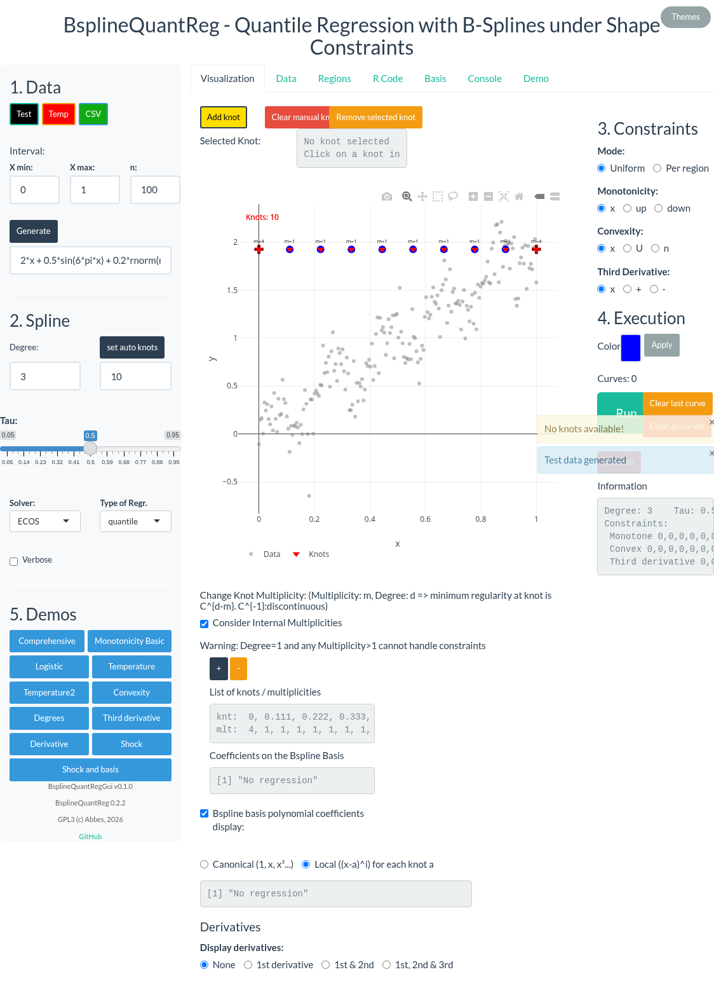
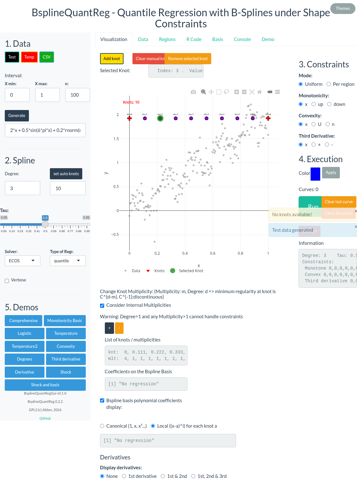
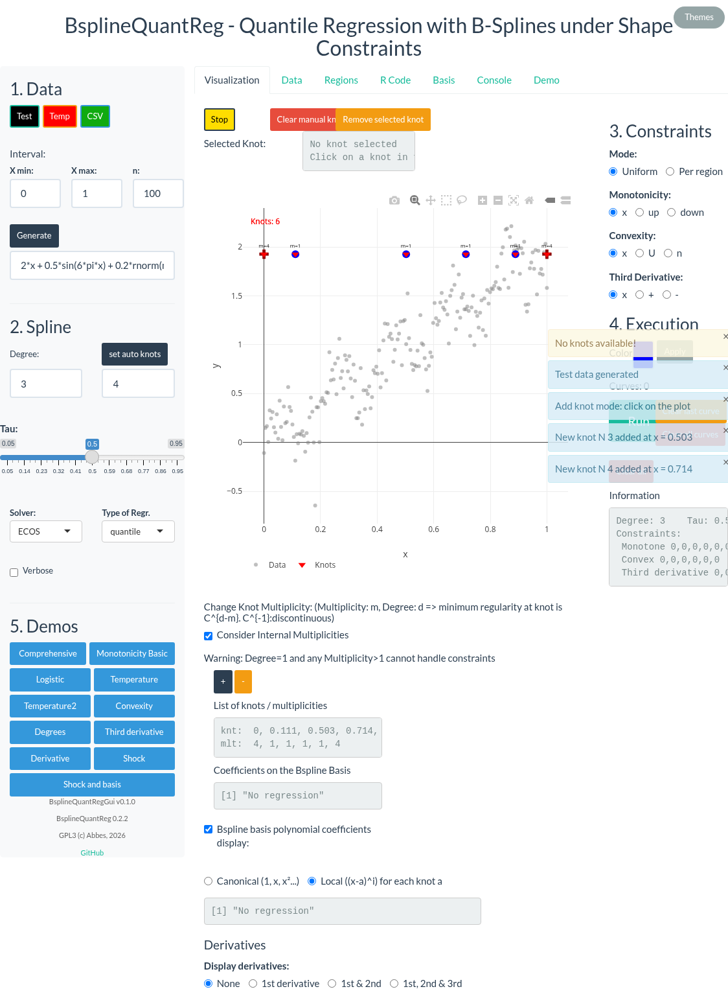
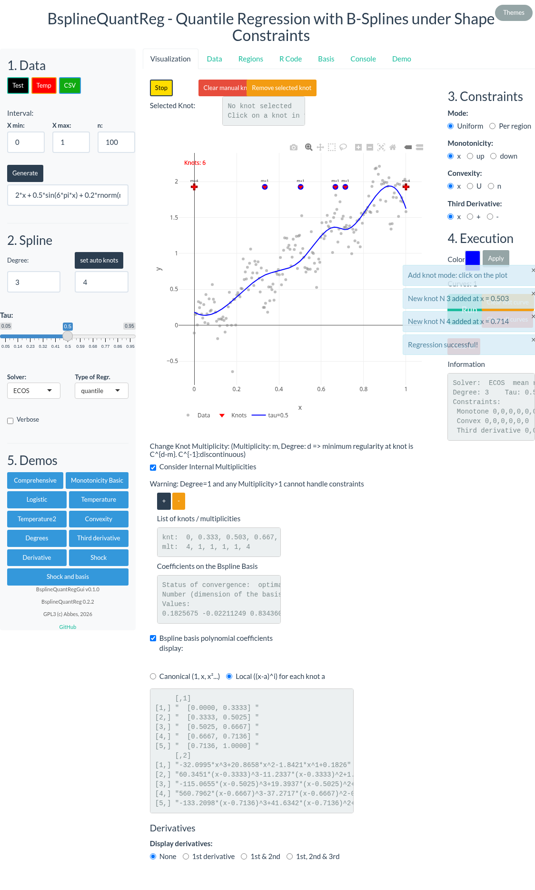
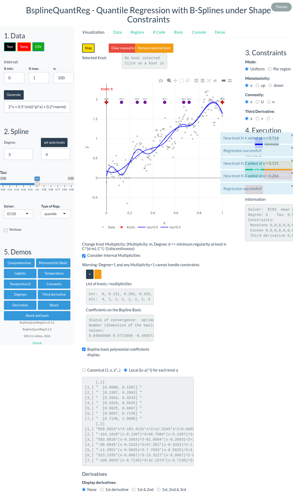
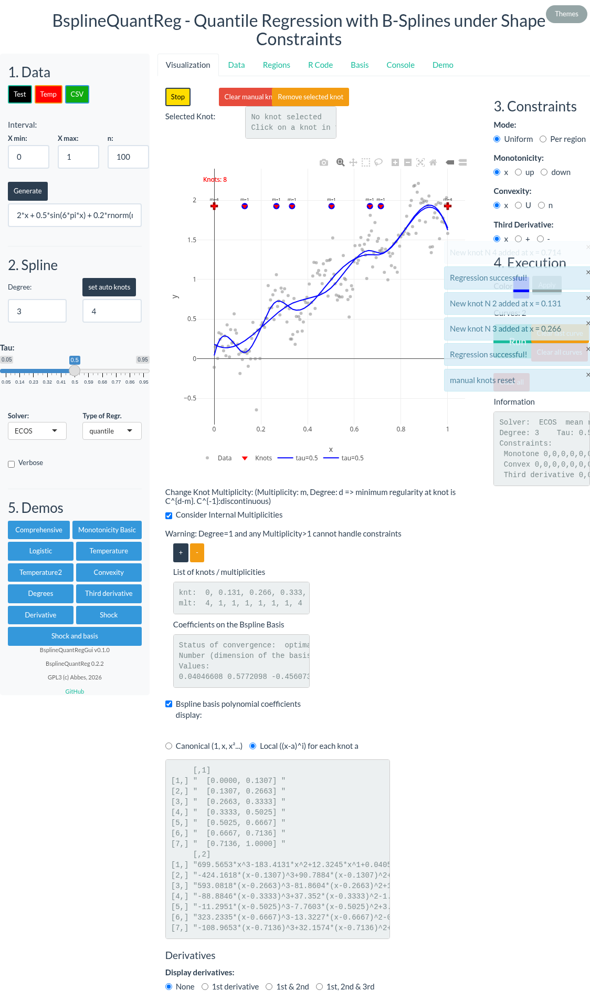
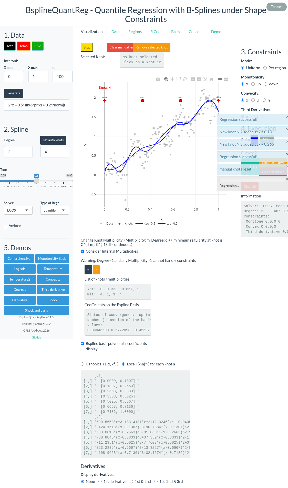

```{r setup, include=FALSE}
knitr::opts_chunk$set(
  collapse = TRUE,
  comment = "#>",
  fig.align = "center",
  out.width = "90%",
  fig.width = 10,
  fig.height = 6,
  dpi = 96
)
```


### Note on the vignettes

This is the only vignette of the package BsplineQuantRegGui. Since
Shiny applications are best documented with pictures, and to limit
the size of the package, we present all the interactive features in this
single vignette. All functionalities are also described in the README.

### Introduction
In this vignette, we show how to add and remove knots to define the spline. 

Two sets of knots exist together:
- The set of regularly spaced knots **auto knots**,
- The set of **manual knots**.
These two sets are joined dynamically to form the full set of knots used by the regression.

The number of auto knots can be changed at any time, this setting applies only once the "auto knot" button is pressed, when the data are defined or loaded. 

It is possible to remove knots from both auto and manual sets. 

Manual knots are added when entering the mode "add knots". Rules:
- it is not possible to add an already existing knot
- One can remove all manual knots at once
- There is no difference in the regression between an "auto not" and a "manual knot"

### Load the data

Click on the Test button to load the demo data with a default set of
knots.
```{r echo=FALSE, out.width="90%", fig.cap="Convexity constraint (Conv = U)"}

```

### Select a knot 
To select a knot, simply click on it in the plot. The selected knot
is highlighted and its index and value appear in the information bar.
```{r echo=FALSE, out.width="90%", fig.cap="Initial set of knots"}

```


### Remove knots
Click on the **Remove selected** knot button several times to remove the
selected knot and the next ones. After each removal, the next knot is
automatically selected.

```{r echo=FALSE, out.width="90%", fig.cap="One knot is selected"}

```

#### Add knots
Click on the Add knot button to enter the manual addition mode. The
button label changes to Stop while the mode is active.

```{r echo=FALSE, out.width="90%", fig.cap="knots are removed"}

```

#### Reduce the number of auto knot

If needed, reduce the number of auto knots (for example to 4). The
change takes effect after pressing **Set auto knots**.

```{r echo=FALSE, out.width="90%", fig.cap="'Add Knot' is selected"}

```

#### Run when ready
Once the knots are set, click on **Run** to fit the spline.
```{r echo=FALSE, out.width="90%", fig.cap="add manual knots"}

```
#### run again with some more knots
You can add more knots and run again to see the effect on the fitted
curve.

```{r echo=FALSE, out.width="90%", fig.cap="regression curve with manual knots"}

```

```{r echo=FALSE, out.width="90%", fig.cap="Regression curve with more knots"}

```
#### Then remove the manual knots (red upper button)
To remove all manual knots at once, click on the red Clear manual
knots button. Auto knots are preserved.

```{r echo=FALSE, out.width="90%", fig.cap="Remove the manual knots "}

```


**See also the demos**, directly accessible from the gui, and visible in the demo tab.
